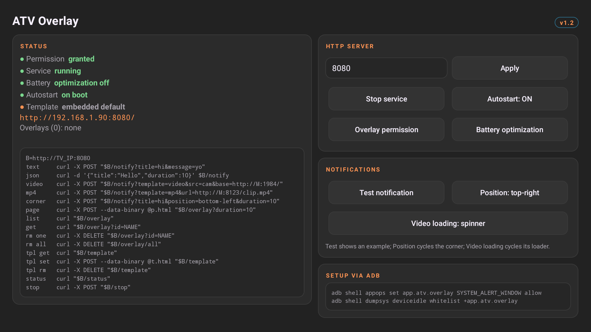
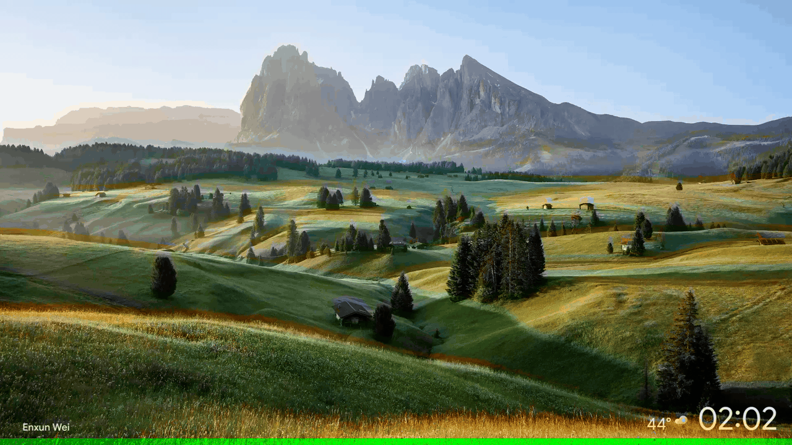
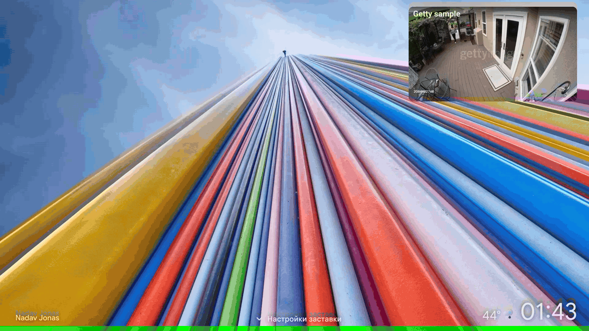
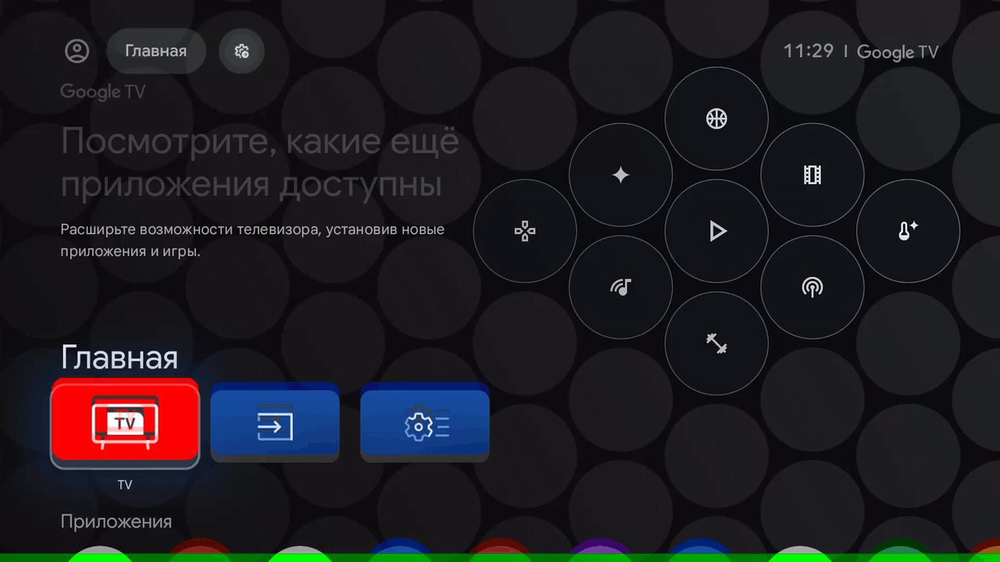
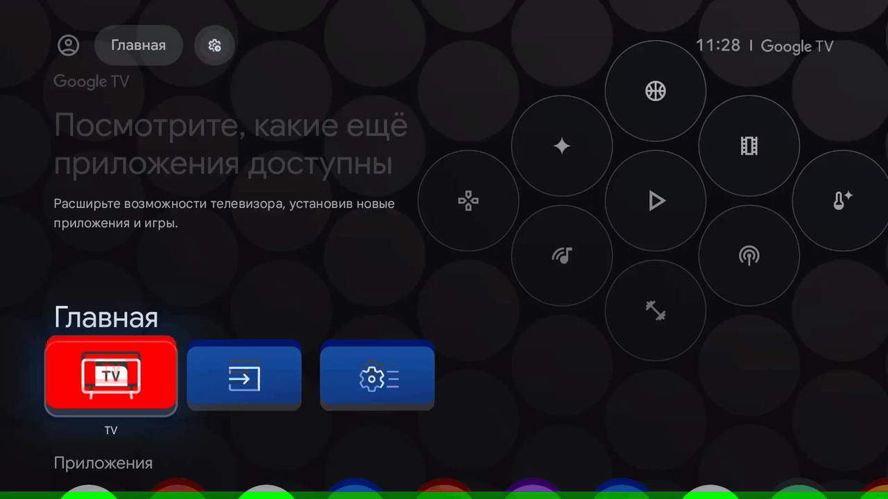

[English](README.md) · [Русский](README.ru.md) · [中文](README.zh-CN.md) · [日本語](README.ja.md)

# ATV Overlay

一个小巧的 Android / Android TV 应用：它内置一个
HTTP 服务器，你用 `POST` 发给它的任意 HTML 都会被渲染到透明的 `WebView`
悬浮窗里，**浮在所有其他应用之上** —— HTML5 视频、实时摄像头画面、仪表盘都不在话下。
常见触发方式：Home Assistant 自动化、CI 流水线、脚本、`curl`。

### 控制面板



| 文字通知 | 视频通知 |
|---|---|
|  |  |

| 打赏卡片 | 片单横幅 |
|---|---|
|  |  |

零预制素材、不用 ExoPlayer：**所有画面都是你运行时发过去的 HTML/CSS/JS，
或者直接内嵌使用内置模板。**

```
curl / script / CI / Home Assistant
        │  POST /overlay  (raw HTML body)
        ▼
NanoHTTPD :8080  ──►  main thread  ──►  WindowManager
 (ApiServer)          (OverlayHub)      TYPE_APPLICATION_OVERLAY
                                        └─ WebView #1 "default"
                                        └─ WebView #2 "ad"      (transparent, JS, autoplay)
                                        └─ WebView #N ...
```

以前台服务方式运行，因此切到后台或打开桌面悬浮窗依然存在；开机自启（可在应用内开关）。

## 特性

- **HTML 进、像素出** —— 原始请求体原样渲染，任意 `Content-Type`，最大 16 MB。
- **命名图层**（`?id=`），每个图层独立的 WebView；对同一 id 重新 POST 即原位替换内容。
- **摆放与动效** —— 位置/尺寸支持像素或百分比（`x,y,w,h`，屏幕旋转时自动重算），
  窗口从最近的屏幕边缘滑入、到期滑出（`anim=`）。
- **自动播放视频** —— 无需用户手势；已处理 HTML5 全屏；不支持 DRM。
- **监控摄像头上大屏** —— `template=video` 通过 WebRTC 低延迟播放
  [go2rtc](https://github.com/AlexxIT/go2rtc) 流（`src=` + `base=`）；
  `template=mp4` 支持 go2rtc 的 `api/stream.mp4` 或任意直链 http(s) MP4
  （Jellyfin、nginx 等）。
- **一个请求发通知** —— `POST /notify?title=&message=`：圆角文本框、摄像头画面框，
  或你自己的布局（`POST /template`），吸附到屏幕角落并带滑入动画。
- **对 Home Assistant 友好** —— 支持扁平 JSON 请求体供自动化 / `rest_command` 使用
  （UTF-8 文本无需 percent 编码）；悬浮窗就是普通 HTML+JS，可以直接在电视上轮询
  HA 的 REST API。
- **自动隐藏**（`duration=`）与**输入模式**（`none`/`touch`/`focus`），
  悬浮窗绝不误抢遥控器。
- 后台存活、重启存活；唯一运行时依赖 [NanoHTTPD](https://github.com/NanoHttpd/nanohttpd)。

## 要求 / 现实情况

- Android 8.0+（`minSdk 26`；`TYPE_APPLICATION_OVERLAY`），target API 33，SDK 34 编译。
- 需要**“显示在其他应用上层”**权限（`SYSTEM_ALERT_WINDOW`）。
  许多 Android TV / Google TV 系统上这个设置页**根本不存在** —— 请改用 ADB 授权。
  个别 OEM 电视彻底拒绝第三方悬浮窗，普通应用无能为力
  （替代方案是系统/特权应用或 PiP，本项目有意不涉及）。
- HTTP 且无鉴权 —— **仅限开发 / 可信局域网**。局域网内任何人都能在你电视上画画
  （你的电视也会去加载他们指定的 URL）。

## 快速开始

```bash
# 1. 构建
./gradlew :app:assembleDebug
# APK: app/build/outputs/apk/debug/app-debug.apk

# 2. 安装到电视/盒子（adb 网络或 USB）
adb install -r app/build/outputs/apk/debug/app-debug.apk

# 3. 授予悬浮窗权限 —— 打开应用点 "Overlay permission"，或（电视上没有该设置页时）：
adb shell appops set app.atv.overlay SYSTEM_ALERT_WINDOW allow

# 4. （推荐）防止电视休眠杀掉应用 —— 在应用内点 "Battery optimization"
#    （对话框里选“不优化”），或：
adb shell dumpsys deviceidle whitelist +app.atv.overlay

# 5. 启动服务 —— 打开应用点 "Start service"，或纯 adb：
adb shell am start-foreground-service -n app.atv.overlay/.OverlayService

# 6. 在你的电脑上：从应用界面/通知里找到电视 IP，然后
curl -X POST --data-binary @samples/overlay.html "http://TV_IP:8080/overlay"
```

离开应用后服务持续运行（前台通知里显示当前 URL）。停止方式：`POST /stop`、
应用里的 *Stop service* 按钮，或 `adb shell am stopservice app.atv.overlay/.OverlayService`。

## HTTP API

基地址 `http://TV_IP:8080`。JSON 错误格式：`{"error":"..."}`。CORS 完全开放。

### `POST /overlay`

把**原始请求体**当 HTML 渲染到图层 `id`（默认 `default`）上。
对同一 id 重新 POST 会原位替换内容（图层不变）；若几何参数有变则重建图层。

| 参数 | 默认值 | 含义 |
|---|---|---|
| `id` | `default` | 图层名 `[A-Za-z0-9._-]{1,64}`；每个图层一个 WebView |
| `x`, `y` | `0` | 距左上角偏移；像素（整数，`120`）或百分比（可带小数，`58%`、`58.5%`） |
| `w`, `h` | `100%` | 尺寸；像素（整数）或百分比（可带小数；百分比四舍五入到整像素） |
| `input` | `none` | `none` = 不可交互，不抢方向键/触摸；`touch` = 可点击，按键仍发给下层应用；`focus` = 可获取焦点/按键（可与你的 HTML 交互，但可能抢走遥控器输入） |
| `duration` | `0` | N 秒后自动移除（`0` = 常驻） |
| `anim` | `auto` | 入场/退场效果：`auto` = 宽度小于约 70% 屏幕时滑入，满宽则淡入；`slide`/`fade` 强制指定；`none` 关闭 |
| `base` | — | 可选的绝对 `http(s)` URL 作为文档 base，使 HTML 里的相对资源 URL 相对于你的 Web 服务器解析 |

成功返回 `200` 和图层 JSON，参数错误 `400`，缺少悬浮窗权限 `503`
（错误体里附上现成的 `adb` 命令）。

```bash
# 全屏闪屏
curl -X POST --data-binary @samples/overlay.html "http://TV_IP:8080/overlay"

# 角落视频小窗，40%x30%，位于 58%,66%，30 秒后自动隐藏
curl -X POST --data-binary @samples/video.html \
  "http://TV_IP:8080/overlay?id=ad&x=58%25&y=66%25&w=40%25&h=30%25&duration=30"

# 让相对 URL 相对你的开发服务器解析
curl -X POST --data-binary @page.html "http://TV_IP:8080/overlay?base=http://192.168.1.20:3000/"
```

（注意：query 参数里的字面量 `%` 必须写成 `%25`。）

### `POST /notify`

显示通知。**请求体为空**时由内置模板渲染（`template=`）：

- `text`（默认）—— 半透明、微圆角、随文字收缩的框（左侧图标，标题在上、
  自动换行的消息在下），窗口为屏幕的 40%×22%，贴近所选角落。
- `video` —— 全铺满的 WebRTC 播放器（无控件、无留白），播放
  [go2rtc](https://github.com/AlexxIT/go2rtc) 流：必须给 `src=` 和 `base=`；
  窗口默认 22%×22%（在 16:9 屏上即 16:9）。默认有声播放 —— `muted=true` 静音。
- `mp4` —— 同款框内的渐进式 MP4 播放器。可用 `url=http(s)://…` 给直链文件
  （Jellyfin/Directus/nginx 谁都能发），或用 `src=` + `base=` 指 go2rtc 流
  （要求同 `video`）。默认带声自动播放；`muted=true` 静音。

`{{TITLE}}` / `{{MESSAGE}}` 会在模板中被替换（经过 HTML 转义）——
如果你发来自定义 HTML 请求体，同样会替换。

| 参数 | 默认值 | 含义 |
|---|---|---|
| `title`, `message` | — | 模板文字；不发 HTML 请求体时至少填一个 |
| `id` | `notification` | 图层 id（规则同 `/overlay`） |
| `template` | `text` | 无请求体时的内置模板：`text` \| `video` \| `mp4` |
| `src` | — | `template=video` 的流名，或 `mp4` 经由 go2rtc 时的流名（如 `camera.aqara_g4_720p`) |
| `url` | — | `template=mp4`：直链 http(s) MP4 地址（优先于 `src`/`base`；不能含空格/引号） |
| `muted` | `false` | 视频模板的声音。`false` 会盖过电视当前的声音播放流音频（默认 —— 门铃摄像头通知的意义所在）；`true` 静默启动，适合长期挂着的摄像头监视窗或多图层抢扬声器的场景。文字模板忽略此参数 |
| `position` | 应用设置 | `top-right` \| `bottom-right` \| `bottom-left` \| `top-left`；覆盖已配置的角落。框距屏幕边缘 `margin%` |
| `margin` | `1` | 角落窗口与屏幕边缘的间距（`0..96`，可带小数，结尾 `%` 可省）；`margin + width` 与 `margin + height` 均需 `<= 100` |
| `width`, `height` | `40`, `22`（`video`/`mp4` 为 `22`, `22`） | 窗口尺寸，占屏幕百分比（`1..96`，可带小数，结尾 `%` 可省）；角落边距由 `margin` 设定。对 `video`/`mp4`，默认 `22`/`22` 在 16:9 电视上恰为 16:9 —— 想放大请等量调大两个值（如 `width=30&height=30` 或 `width=40&height=40`）以保持比例 |
| `duration` | `5` | N 秒后自动隐藏（`0` = 常驻） |
| `anim` | `auto` | 入场/退场：`auto` \| `slide` \| `fade` \| `none` —— 通知默认从最近边缘滑入 |
| `loading` | 应用设置（`spinner`） | 流的首帧仍在缓冲时视频框的行为（持久化默认值；用应用的 *Video loading* 按钮循环切换）。`spinner` = 框立即出现并带加载转圈，视频就绪后替换它；`hide` = 首帧之前屏幕上什么都不出现，然后带着实时画面淡入 —— 适合根本不想展示坏掉/加载中摄像头的场景；`native` = 原样展示浏览器播放器，大播放按钮一应俱全。`spinner`/`hide` 模式下流报错时仍会显示框并带错误信息，故障绝不会无声无息 |
| `base` | — | 作为页面 base URL/origin 的绝对 http(s) URL —— 让自定义请求体能使用相对资源与同源 WebSocket API（如 go2rtc `api/ws`） |

```bash
curl -X POST "http://TV_IP:8080/notify?title=Build%20done&message=apk%20is%20ready"
curl -X POST "http://TV_IP:8080/notify?title=Deployed&position=bottom-left&duration=10"
curl -X POST --data-binary @mylayout.html "http://TV_IP:8080/notify?title=Custom"   # 请求体替换模板
curl -X POST "http://TV_IP:8080/notify?title=Camera&template=video&src=cam720&base=http://MEDIA_IP:1984/"
curl -X POST "http://TV_IP:8080/notify?template=mp4&title=Sample&url=http://MEDIA_IP:8123/local/clip.mp4&width=28.6&height=28.6"
```

所有参数也可以扁平 JSON 请求体发送 —— 对本来需要 percent 编码的 UTF-8 文本
（标题、消息）很方便。以 `{` 开头的请求体一律视为参数（绝不当作 HTML 覆盖），
且 JSON 值优先于 query string：

```bash
curl -H 'Content-Type: application/json' \
  -d '{"title":"Camera","message":"Motion detected","duration":10}' \
  "http://TV_IP:8080/notify"
curl -H 'Content-Type: application/json' \
  -d '{"title":"Camera","template":"video","src":"cam720","base":"http://MEDIA_IP:1984/"}' \
  "http://TV_IP:8080/notify"
```

接受数字/布尔值（`"duration": 10`、`"muted": true`）；嵌套对象/数组会以 `400` 拒绝。

通知本质上只是一个带普通 id 的图层（默认 `notification`），
所以 overlay 端点同样适用于它：`DELETE /overlay?id=notification`
立即将其移除（倒计时被取消），而 `GET /overlay?id=notification`
返回当前正在显示的**渲染后 HTML**（消失后返回 `404`）：

```bash
curl -X DELETE "http://TV_IP:8080/overlay?id=notification"  # stop it early
curl         "http://TV_IP:8080/overlay?id=notification"    # inspect live HTML
```

### 通知模板

默认文字布局内置在应用里（`Notifications.DEFAULT_TEXT_TEMPLATE`）。
可以在运行时换掉它 —— 覆盖会被持久化（服务重启后依然生效）：

```bash
curl "http://TV_IP:8080/template" -o tpl.html          # 当前模板（响应头标明 embedded|override）
curl -X POST --data-binary @tpl.html "http://TV_IP:8080/template"   # 覆盖
curl -X DELETE "http://TV_IP:8080/template"            # 恢复内置默认
```

自定义模板就是通知窗口的内容（页面背景保持透明）；把 `{{TITLE}}` / `{{MESSAGE}}`
放在你想显示请求文字的位置。窗口几何 —— 从而角落摆放 —— 由应用负责，
与模板无关。`video` 模板（`Notifications.DEFAULT_VIDEO_TEMPLATE`）不受 `/template` 影响。

两个内置视频模板也遵从 `loading=`（spinner / hide / native，见上）：
该选项作用于流首帧加载期间，且出错时总会显示出来，故障不会被漏掉。
自定义请求体与自定义模板若需要加载 UI，需自行实现。

### Home Assistant + go2rtc 摄像头上电视

把 Home Assistant 自动化指向电视：扁平 JSON 请求体免除了 UTF-8 文本的
percent 编码，`template=video` 把悬浮窗变成低延迟 WebRTC 播放器。
电视上无需安装任何额外东西 —— go2rtc 同时提供信令（`api/ws`，经由 `base=` 访问）和流本身：

```yaml
# configuration.yaml
rest_command:
  tv_doorbell:
    url: "http://TV_IP:8080/notify"
    method: POST
    headers: { Content-Type: "application/json" }
    body: >-
      {"title":"Doorbell","template":"video","src":"cam720",
       "base":"http://GO2RTC_HOST:1984/","duration":20}
```

```yaml
# automation
- alias: 在电视上显示门铃摄像头
  trigger:
    - platform: state
      entity_id: binary_sensor.doorbell
      to: "on"
  action:
    - service: rest_command.tv_doorbell
```

同一摄像头改用渐进式（设备兼容性更好，延迟略高）：JSON 里用 `"template":"mp4"`，或：

```bash
curl -X POST "http://TV_IP:8080/notify?template=mp4&src=cam720&base=http://GO2RTC_HOST:1984/&duration=20"
```

悬浮窗本质就是个 WebView：它的 JavaScript 也能直接调用 Home Assistant 的
REST API（写 `input_text`、触发 TTS、拉取传感器数据）—— 就在页面里完成。

### 其他端点

| 端点 | 用途 |
|---|---|
| `GET /` | 使用帮助 JSON |
| `GET /ping` | `pong` |
| `GET /status` | 服务器 + 权限 + 活动图层列表 |
| `GET /overlay` | 图层列表（JSON） |
| `GET /overlay?id=ad` | 单个图层的存储 HTML（`text/html`） |
| `DELETE /overlay?id=ad` | 移除一个图层 |
| `DELETE /overlay/all` | 移除所有图层 |
| `POST /notify?title&message&id&position&duration&loading` | 显示通知（见上文） |
| `GET /template` | 当前通知模板（`text/html`；`X-Template-Source: embedded\|override`） |
| `POST /template` | 用原始 HTML 请求体替换默认通知模板 |
| `DELETE /template` | 将通知模板重置为内置默认 |
| `POST /stop` | 停止前台服务 |

## HTML 技巧

- **透明度**：保持页面背景透明，否则会把底下的电视画面糊成一片：
  `html, body { background: transparent; }`（samples 都这么写）。
- **视频**：`<video autoplay muted playsinline src="...">`。已开启无需手势的
  autoplay，所以 `muted` 可省 —— 想要盖过电视当前声音就别写（不协商音频焦点）。
  这些 WebView **不**提供 DRM（Widevine）；只支持普通 mp4/webm/部分系统的 HLS。
- **相对 URL** 没有 `?base=` 不会解析；请把 CSS/JS 内联或使用绝对 URL。
- 元素的 `requestFullscreen()`（如 `<video fullscreen>`）已处理：该视图会获得
  自己的全屏图层，退出后回到它的 WebView。

## 项目结构

```
app/src/main/java/app/atv/overlay/
├── OverlayService.kt   前台服务；持有 hub + HTTP 服务器；通知
├── OverlayHub.kt       WindowManager 图层管理器（每 id 一个 WebView，切主线程）
├── ApiServer.kt        NanoHTTPD 路由（/overlay、/notify、/template、/status、/stop ...）
├── MainActivity.kt     权限 UI、服务控制、URL 展示（纯代码布局，无 XML）
├── BootReceiver.kt     BOOT_COMPLETED / 应用更新时自启
├── Notifications.kt    /notify：内置模板、占位符、角落几何（纯 Kotlin）
├── Prefs.kt            端口 + 自启设置，局域网 IPv4 枚举
└── Json.kt             JSON 写入器 + HttpException
```

## 设计说明

- **HTTP 层**：NanoHTTPD（唯一依赖）。请求体直接读自 session 流而非
  `parseBody`，因此*任何* `Content-Type` 都能承载原始 HTML（包括 curl 默认的
  `x-www-form-urlencoded`），DELETE 的请求体也会被读干，以保持 keep-alive 连接的协议完整性。
- **线程模型**：HTTP 跑在 NanoHTTPD 线程上；每次 `WindowManager` 调用都切到主线程
  并等待返回（上限 10 秒），因此响应与屏幕实际内容一致。
- `targetSdk 33` 是刻意选择 —— 侧载开发工具不做 foreground-service-type 的仪式；
  `usesCleartextTraffic=true` 让 HTML 能引用 `http://` 资源/视频。
- 请求体上限 16 MB（内联资源的 HTML 通常 <1 MB）。

## 疑难排查

| 症状 | 解决办法 |
|---|---|
| `503 overlay permission not granted` | `adb shell appops set app.atv.overlay SYSTEM_ALERT_WINDOW allow`（若报错试试 `android:system_alert_window` 写法）；再查 `GET /status` |
| 过一会儿服务消失 | OEM 激进杀后台：`adb shell dumpsys deviceidle whitelist +app.atv.overlay`；某些厂商 ROM 仍会杀 —— 试试“忽略电池优化”开关 |
| 已授权但悬浮窗从不出现 | 部分电视厂商彻底封杀第三方悬浮窗 —— 换一台设备/盒子测试 |
| 视频区域全黑 | 已强制硬件加速图层；个别芯片仍拒绝在悬浮窗内渲染视频 —— 用 `adb shell am start` 在普通 WebView Activity 里打开 `samples/video.html` 以隔离问题 |
| 端口被占 / 想换端口 | 在应用 UI 里改端口（服务器会重启）—— 服务未运行前千万别 `POST /overlay` |
| 什么都没画，但 `GET /overlay` 里列出了图层 | 你的页面背景不透明 / 全都 `position:fixed` 出了视口 —— 在桌面浏览器里打开存储的页面（`GET /overlay?id=x` 会返回其 `text/html`）看看 |
